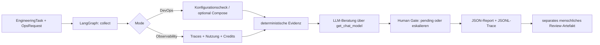

# Operations & Observability Agent – Termin 2 / 3

**Verantwortlicher Mensch:** Mirko  
**Agent:** `ops-agent` (`src/agents/ops_agent.py`)  
**Status:** operational (echte Ollama-Ausführung mit `qwen3:4b`, Docker-Compose-Validierung, Trace-Evidenz unter `evidence/session-02/ops-agent-trace.jsonl` und separate Human-Review-Artefakte unter `evidence/session-02/ops-*-report.review.json` liegen vor).

## Auftrag / Rollenabgrenzung

Ein **LangGraph-Agent** bietet zwei klar unterscheidbare Fähigkeiten:

| Rolle (`assigned_role`) | Mode | Reales Tool | Strukturierter Output |
|---|---|---|---|
| `devops_engineer` | `devops` | `inspect_devops_tool`: Konfigurationen lesen und prüfen, optional `docker compose config --quiet` | `OpsResult.devops`: Checkliste, Compose-Validierung, Findings |
| `cost_observability_engineer` | `observability` | `analyze_cost_traces_tool`: lokale JSONL-Traces und `costs/usage.csv` auswerten | `OpsResult.observability`: Runs, Calls, Laufzeiten, Token-Verfügbarkeit, Credits, menschliche Reviewzeit |

Der Agent verwendet das **gemeinsame `EngineeringTask`-Modell** aus `src/agents/task_models.py` (`src/models/tasks.py`). Ein Adapter in `src/agents/task_handoffs.py` sowie `src/agents/platform_agent.py` und `src/agents/quality_agent.py` verarbeiten dasselbe gemeinsame Task-Format mit durchgängiger `task_id` und `workflow_id`.

## Workflow



Eine fehlerhafte Toolausführung führt direkt zur Eskalation, nicht zu einem erfundenen LLM-Resultat. Modellaufrufe werden in einem separaten Prozess nach `timeout_seconds` abgebrochen (default 30 Sekunden, maximal 120). Der Graph hat keine Schleifen und ein `recursion_limit` von 6. Ein erfolgreicher Audit behauptet **nicht**, dass ein Produktions-Deployment stattfand.

## Ausführung

Zuerst gemäß Kursanleitung Python 3.12, `.venv`, `.env` sowie die gepinnten Pakete aus `requirements.txt` einrichten. Sämtliche Befehle im Repository-Root ausführen.

**DevOps-Audit mit echtem Ollama-/ICC-Aufruf:**

```bash
python -m src.agents.ops_agent run --mode devops --task-id SESSION-02-OPS-DEVOPS --check-compose
```

`--check-compose` führt nur `docker compose config --quiet` aus, **keinen** Build und **kein** Deployment. Wird Docker nicht gefunden, steht dies explizit im Bericht. Ohne `--check-compose` ist die rein statische Prüfung möglich und wird als nicht vollständig verifiziert ausgewiesen.

**Taskbezogene Kosten eines bestehenden Workflows:**

```bash
python -m src.agents.ops_agent run --mode observability --task-id SESSION-02-OPS-COST --observed-task-id DRYRUN-WORKITEMS-E2E --budget-credits 200
```

Standardmäßig werden `.jsonl`-Dateien unter `logs/` und `evidence/` gesammelt; alternative erlaubte Eingaben können mit `--input evidence/session-02/platform-agent-trace.jsonl` eingeschränkt werden. Maximal 100 Dateien, 5000 Trace-Zeilen, 1 MB/Datei; keine Dateizugriffe außerhalb der zugelassenen Bereiche. `--no-llm` erlaubt einen **Offline-Funktionstest**, ist aber **kein Nachweis eines echten LLM-Laufs**.

**Menschliche Entscheidung (erst nach Prüfung der Reports):**

```bash
python -m src.agents.ops_agent review --report evidence/session-02/ops-devops-report.json --reviewer mirko --decision approved --notes "Docker Compose config und CI-Checks verifiziert"
```

Der Befehl schreibt `<run_id>.review.json` mit Reviewer, Zeitpunkt, Task, Run, Entscheidung und SHA-256-Fingerprint des geprüften Reports. Die ursprüngliche Report-Datei bleibt unverändert; eine einmal vorhandene Review-Datei wird nicht überschrieben. `approved` ist niemals ein LLM-Ergebnis.

## Kostenlogik

Basis sind die festen Kurs-Raten aus `src/app/settings.py`/`src/observability/tracing.py`:

- **LLM-Calls:** 1 Credit pro Call, fehlgeschlagene Versuche und Wiederholungen eingeschlossen.
- **Laufzeit:** 0,01 Credits/Sekunde.
- **Input-Tokens:** 0,02 Credits/1000 Tokens.
- **Output-Tokens:** 0,04 Credits/1000 Tokens.
- **Menschliche Arbeit:** 100 Credits/Stunde (aus `costs/usage.csv`; inkl. explizit als `Review` / `Correction` gekennzeichneter Aufwände).
- **CI:** 1 Credit je Run aus `costs/usage.csv`.

Für ältere Traces ohne `calls` nimmt die Analyse **einen Call pro Run als Schätzung** an und kennzeichnet diese Annahme. Doppelte exportierte Trace-Runs werden anhand `(run_id, agent)` nur einmal gezählt. Wenn Token-Daten fehlen, bleiben `input_tokens`/`output_tokens` als **vollständige** Task-Totale `null`, während `recorded_input_tokens`/`recorded_output_tokens` die tatsächlich gemessenen Teilsummen erhalten. Mensch/CI wird aus `costs/usage.csv` addiert, `actor_type=agent` aus der CSV bewusst ignoriert, damit Agentenkosten nicht doppelt gezählt werden.

## Human-Gate / Berechtigungen

- `inspect_devops_tool` liest ausschließlich fünf konkrete Infrastrukturdateien. Es gibt keine Shell-Freigabe; als einziger optionaler Subprozess ist das unveränderliche `docker compose ... config --quiet` erlaubt.
- `analyze_cost_traces_tool` liest ausschließlich `logs/**/*.jsonl`, `evidence/**/*.jsonl` und die vorgegebene `costs/usage.csv`.
- **Keine** Änderungen an Docker, CI, Git, Deployments, Secrets oder Datenbank durch den Agenten; keine automatischen Rollbacks.
- `approval_decision` bleibt `pending` bzw. `escalate_to_human`, bis ein Mensch getrennt ein Review-Artefakt erzeugt.

## Tests und Evidenz

```bash
python -m pytest
python -m pytest tests/test_ops_agent.py -q
```

**Vorliegende Evidenz (`evidence/session-02/`):**
- `evidence/session-02/ops-agent-trace.jsonl`: Echte Ausführungstraces mit Ollama `qwen3:4b` für `devops_engineer` (inkl. bestandenem `docker compose config --quiet`) und `cost_observability_engineer`.
- `evidence/session-02/ops-devops-report.json` & `.review.json` sowie `evidence/session-02/ops-observability-report.json` & `.review.json`: Strukturierte Audit-Berichte und kryptografisch gebundene menschliche Review-Entscheidungen.
