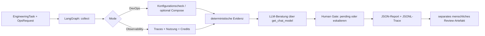

# Operations & Observability Agent – Termin 2

**Verantwortlicher Mensch:** Mirko  
**Agent:** `ops-agent` (`src/agents/ops_agent.py`)  
**Status:** implementiert, lokale LLM-Ausführung und echte CI-/Docker-Verifikation im Team noch nachzuweisen.

## Auftrag / Rollenabgrenzung

Ein **LangGraph-Agent** bietet zwei klar unterscheidbare Fähigkeiten:

| Rolle (`assigned_role`) | Mode | Reales Tool | Strukturierter Output |
|---|---|---|---|
| `devops_engineer` | `devops` | `inspect_devops_tool`: Konfigurationen lesen und prüfen, optional `docker compose config --quiet` | `OpsResult.devops`: Checkliste, Compose-Validierung, Findings |
| `cost_observability_engineer` | `observability` | `analyze_cost_traces_tool`: lokale JSONL-Traces und `costs/usage.csv` auswerten | `OpsResult.observability`: Runs, Calls, Laufzeiten, Token-Verfügbarkeit, Credits, menschliche Reviewzeit |

Der Agent verwendet das **gemeinsame `EngineeringTask`-Modell** aus `src/agents/task_models.py`. Ein leichter Adapter in `src/agents/task_handoffs.py` erlaubt dem bestehenden QA-Agenten, dasselbe Task-Format anzunehmen. Für einen übergreifenden Workflow können andere Agenten dieselbe `task_id` und `workflow_id` übergeben. Es wird **kein** fertiger orchestrierter QA→Ops-Workflow behauptet; den muss das Team gemeinsam implementieren.

## Workflow



Eine fehlerhafte Toolausführung führt direkt zur Eskalation, nicht zu einem erfundenen LLM-Resultat. Modellaufrufe werden in einem separaten Prozess nach `timeout_seconds` abgebrochen (default 30 Sekunden, maximal 120). Der Graph hat keine Schleifen und ein `recursion_limit` von 6. Ein erfolgreicher Audit behauptet **nicht**, dass CI, Build oder Deployment tatsächlich erfolgreich liefen.

## Ausführung

Zuerst gemäß Kursanleitung Python 3.12, `.venv`, `.env` sowie die gepinnten Pakete aus `requirements.txt` einrichten. Sämtliche Befehle im Repository-Root ausführen.

**DevOps-Audit mit echtem Ollama-/ICC-Aufruf:**

```bash
python -m src.agents.ops_agent run --mode devops --task-id SESSION-02-OPS-DEVOPS --check-compose
```

`--check-compose` führt nur `docker compose config --quiet` aus, **keinen** Build und **kein** Deployment. Wird Docker nicht gefunden, steht dies explizit im Bericht. Ohne `--check-compose` ist die rein statische Prüfung möglich und wird als nicht vollständig verifiziert ausgewiesen.

**Taskbezogene Kosten eines bestehenden QA-Runs:**

```bash
python -m src.agents.ops_agent run --mode observability --task-id SESSION-02-OPS-COST --observed-task-id SESSION-01-QA --budget-credits 20
```

Standardmäßig werden `.jsonl`-Dateien unter `logs/` und `evidence/` gesammelt; alternative erlaubte Eingaben können mit `--input evidence/session-01/qa-test-agent-trace.jsonl` eingeschränkt werden. Maximal 100 Dateien, 5000 Trace-Zeilen, 1 MB/Datei; keine Dateizugriffe außerhalb der zugelassenen Bereiche. `--no-llm` erlaubt einen **Offline-Funktionstest**, ist aber **kein Nachweis eines echten LLM-Laufs**.

Reports entstehen in `reports/ops/<run_id>.json`, maschinenlesbare Traces gemäß `TRACE_FILE` standardmäßig in `logs/<run_id>.jsonl`. Für die GitHub-Abgabe nur geprüfte, bereinigte eigene Traces und Reports nach `evidence/session-02/` kopieren. Test-Traces aus FakeLLM bzw. Offline-Läufen sind eindeutig so zu kennzeichnen und nicht als echte Modell-Ausführung zu präsentieren. Echte Secrets und Kundendaten dürfen nicht committed werden.

**Menschliche Entscheidung (erst nach Prüfung der Reports):**

```bash
python -m src.agents.ops_agent review --report reports/ops/<run_id>.json --reviewer Mirko --decision changes_requested --notes "CI-Lauf noch prüfen"
```

Der Befehl schreibt `<run_id>.review.json` mit Reviewer, Zeitpunkt, Task, Run, Entscheidung und SHA-256-Fingerprint des geprüften Reports. Die ursprüngliche Report-Datei bleibt unverändert; eine einmal vorhandene Review-Datei wird nicht überschrieben. Eine Entscheidung ist eine **manuell eingegebene Attestierung**, keine automatisierte Authentifizierung und kein tatsächliches Deployment. `approved` ist niemals ein LLM-Ergebnis.

## Kostenlogik

Basis sind die festen Kurs-Raten aus `src/app/settings.py`/`src/observability/tracing.py`:

- **LLM-Calls:** 1 Credit pro Call, fehlgeschlagene Versuche einschließlich.
- **Laufzeit:** 0,01 Credits/Sekunde.
- **Input-Tokens:** 0,02 Credits/1000 Tokens.
- **Output-Tokens:** 0,04 Credits/1000 Tokens.
- **Menschliche Arbeit:** 100 Credits/Stunde (aus `costs/usage.csv`; bereits ausgewiesene Credits werden berücksichtigt).
- **CI:** 1 Credit je Run aus `costs/usage.csv`.

Für ältere Traces ohne `calls` nimmt die Analyse **einen Call pro Run als Schätzung** an und kennzeichnet diese Annahme. Doppelte exportierte Trace-Runs werden anhand `(run_id, agent)` nur einmal gezählt. Wenn Token-Daten fehlen, bleiben `input_tokens`/`output_tokens` als **vollständige** Task-Totale `null`, während `recorded_input_tokens`/`recorded_output_tokens` die tatsächlich gemessenen Teilsummen erhalten. Die Credits sind dann lediglich eine **Untergrenze**. Mensch/CI wird aus `costs/usage.csv` addiert, `actor_type=agent` aus der CSV bewusst ignoriert, damit Agentenkosten nicht doppelt gezählt werden. Review-Zeit gilt nur als erfasst, wenn für den Task eine entsprechende Human-Hours-Zeile vorhanden und als Review/Korrektur gekennzeichnet ist.

Der Ops-Lauf selbst bekommt separat einen Trace mit seinen eigenen Credits. Das `observability`-Ergebnis berichtet über den **beobachteten** Task, nicht über die Kosten des gerade laufenden Audit-Agents.

## Human-Gate / Berechtigungen

- `inspect_devops_tool` liest ausschließlich fünf konkrete Infrastrukturdateien. Es gibt keine Shell-Freigabe; als einziger optionaler Subprozess ist das unveränderliche `docker compose ... config --quiet` erlaubt.
- `analyze_cost_traces_tool` liest ausschließlich `logs/**/*.jsonl`, `evidence/**/*.jsonl` und die vorgegebene `costs/usage.csv`.
- **Keine** Änderungen an Docker, CI, Git, Deployments, Secrets oder Datenbank durch den Agenten; keine automatischen Rollbacks.
- `approval_decision` bleibt `pending` bzw. `escalate_to_human`, bis ein Mensch getrennt ein Review-Artefakt erzeugt.
- Deployments benötigen darüber hinaus einen **technisch erzwungenen** Gate im echten CI-/CD-Prozess. Eine Review-Datei allein erfüllt diese Sicherung nicht.

## Tests und Termin-2-Evidenz

```bash
python -m pytest
python -m pytest tests/test_ops_agent.py -q
```

Die eigenen Tests prüfen beide Fähigkeiten, das gemeinsame Task-Modell, tokenbasierte Credits, Duplikate, Mensch/CI, Budgetwarnungen, Fehlereingaben, Trace-Erzeugung, LLM-Fallback, terminierendes Escalation-Verhalten und explizite menschliche Entscheidungen. Das bestehende QA-Modul bleibt unverändert.

**Noch durch das Team zu erledigen:** echten Ollama-/ICC-Lauf durchführen und Trace exportieren; CI-/Docker-Befunde mit tatsächlicher Ausführung verifizieren; Review-Artefakt mit echtem Reviewer erzeugen; in den teamübergreifenden Agent-to-Agent-Workflow einbinden; `costs/usage.csv` für Termin 2 mit realem menschlichem Review-Aufwand pflegen; `docs/dry-run-01.md` auf Basis des echten Work-Item-Dry-Runs ausfüllen. Erst nach echter agentischer Ausführung/Evidenz `implementation_status` in `roles.yaml` auf `operational` setzen.
