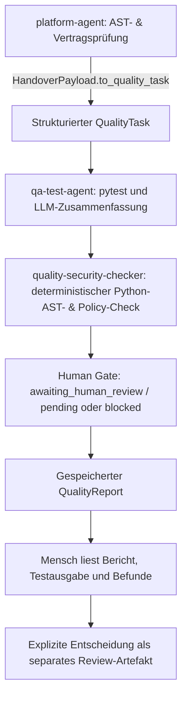

# Quality-Agent: Tests, deterministischer Security-Checker und menschliches Review

Stand: 26. Oktober 2026 (Termin 2 / Vorbereitung Termin 3).

## Was tatsächlich zusammenarbeitet

`src.agents.quality_agent` orchestriert zwei getrennte Prüfer über LangGraph und ist über das gemeinsame `EngineeringTask`/`QualityTask`-Modell (`src/models/tasks.py`) sowie `HandoverPayload` (`src/agents/task_models.py`) mit dem `platform-agent` (`src/agents/platform_agent.py`) verbunden:



Beide Prüfer verwenden das gemeinsame Modell aus `src/models/tasks.py` und den Task-Kanal des `EngineeringState` (siehe `docs/TASK_MODEL_DE.md`). Sie erhalten dasselbe `QualityTask`-Objekt mit derselben `task_id` und `workflow_id`, besitzen eigene Run-IDs und liefern strukturierte Ergebnisse. Der deterministische Security-Checker (`src/agents/security_agent.py`) bekommt zusätzlich das QA-Ergebnis aus dem State (`upstream_qa_run_id`) und prüft dessen Freigabepflicht sowie die Konsistenz eines Erfolgsstatus.

Auch die persistente Work-Item-API (`src/app/main.py`, `src/app/db.py`, `tests/test_work_items_api.py`) sowie der Entwickler-/Architektur-Agent (`src/agents/dev_architect_agent.py`) und der Operations-Agent (`src/agents/ops_agent.py`) sind im Repository vollständig implementiert und über den End-to-End-Workflow (`DRYRUN-WORKITEMS-E2E`) verifiziert.

## Verbindliche Regeln & Charakterisierung des Security-Checkers

- **QA (`qa-test-agent`):** pytest-Exit-Code 0 bedeutet `passed`, 1 `failed`, 5 `needs_review` (keine Tests). Andere Exit-Codes sowie fehlende Ausführung bedeuten `error`. Das LLM (`qwen3:4b` mit `reasoning=False, json_mode=True`) formuliert Zusammenfassung und Befunde, kann aber technischen Status, Exit-Code und Freigabepflicht niemals ändern.
- **Deterministischer Security-Checker (`security-agent` / `quality-security-checker`):** Bewusst als **deterministischer statischer Python-AST- und Policy-Prüfer ohne LLM-Aufruf** realisiert, um Mirko (`ai_safety_security_engineer`) verlässlich und reproduzierbar zu unterstützen:
  - Prüft per Python-AST (`inspect_python`) Dateien unter `src/` und `tests/` (max. 256 KB; `.env` und Pfade außerhalb des Scopes werden strikt abgewiesen).
  - Erkennt direkte `eval`/`exec`-Aufrufe (`dynamic_code_execution`), `os.system`/`os.popen` und `subprocess.*(..., shell=True)` (`shell_execution`) sowie potenzielle Credential-Literale (`literal_credentials`), ohne jemals Secret-Werte im Klartext auszugeben.
  - Prüft auf Workflow-Ebene die Integrität des vorgelagerten QA-Ergebnisses (`technical_status_integrity` und `human_approval_policy`).
- **Erzwungenes Human Gate:** `human_approval_required` bleibt immer `true`. Ein erfolgreicher Run endet mit `awaiting_human_review` und `human_decision=pending`; fehlgeschlagene Prüfungen mit `blocked`. Erst `record_human_review()` schreibt eine separate `*.review-<id>.json` mit `report_sha256` und `artifact_sha256`.

## PowerShell: Tests starten (inkl. echter PostgreSQL-Persistenz ohne Skip)

```powershell
# PostgreSQL-Container starten und Schema initialisieren
docker compose up -d db --wait
Get-Content db/init.sql | docker compose exec -T db sh -c 'psql -U "$POSTGRES_USER" -d "$POSTGRES_DB" -v ON_ERROR_STOP=1'

# Vollständiger Testlauf mit aktivierter PostgreSQL-Prüfung (123 passed, 0 skipped)
$env:STARTER_DATABASE_TEST = '1'
.\.venv\Scripts\python.exe -m pytest -v --junitxml=evidence/session-02/pytest.xml
```

## PowerShell: Workflow und menschliches Review ausführen

```powershell
# Vollständiger Quality-Workflow (QA + deterministischer Security-Check + Human Gate)
.\.venv\Scripts\python.exe -m src.agents.quality_agent run --task-id DRYRUN-WORKITEMS-E2E --pytest-target tests/test_work_items_api.py --artifact src/app/main.py --artifact src/app/db.py --timeout-seconds 120 --report evidence/session-02/work-items-quality-report.json --trace-file evidence/session-02/work-items-quality-trace.jsonl

# Explizite menschliche Freigabe als separates Review-Artefakt
.\.venv\Scripts\python.exe -m src.agents.quality_agent review --report evidence/session-02/work-items-quality-report.json --reviewer felix --decision approved
```
