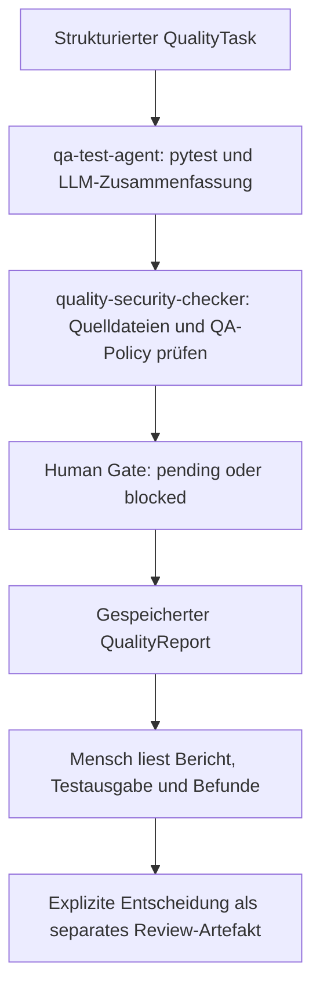

# Quality-Agent: Tests, Security und menschliches Review

Stand: 19. Oktober 2026. Diese Erweiterung ändert keine Rollen- oder Organisationsdateien.

## Was tatsächlich zusammenarbeitet

`src.agents.quality_agent` orchestriert zwei getrennte Prüfer über LangGraph:



Beide Prüfer erhalten dieselbe Task-/Workflow-ID, besitzen eigene Run-IDs und liefern
strukturierte Ergebnisse. Security bekommt zusätzlich das QA-Ergebnis aus dem State
und prüft dessen Freigabepflicht sowie die Konsistenz eines Erfolgsstatus. Der Security-Trace
verweist auf die Run-ID des QA-Agenten. Es gibt keine Copy/Paste-Übergabe zwischen den Prüfern.

Der bestehende QA-Agent bleibt separat aufrufbar. Ein eigener Entwickler-Agent und eine
Work-Item-API sind in diesem Stand noch nicht implementiert. Ein späterer Entwickler-Agent
kann einen `QualityTask` übergeben; diese Schnittstelle ersetzt keinen echten Entwicklerlauf.
Der Referenzagent unter `examples/` ist weiterhin Starter-Code und kein eigener Leistungsnachweis.

## Verbindliche Regeln

- pytest-Exit-Code 0 bedeutet `passed`, 1 `failed`, 5 `needs_review` (keine Tests).
  Andere Exit-Codes sowie fehlende Ausführung bedeuten `error`.
- Das LLM formuliert Zusammenfassung und Befunde. Es kann Status, Exit-Code und
  Freigabepflicht nicht ändern. Testausgaben gelten im Prompt als unvertrauenswürdige Daten.
- `summary_status` zeigt separat `ok`, `invalid_output` oder `unavailable` an.
  Ein ausgefallenes LLM löscht kein technisches Testergebnis.
- `human_approval_required` bleibt immer `true`. Ein erfolgreicher Run endet mit
  `awaiting_human_review` und `human_decision=pending`; fehlgeschlagene Prüfungen mit `blocked`.
- Der Workflow hat keine Schleife, eine feste Graphgrenze und ein pytest-Zeitlimit.
  Der konfigurierte LLM-Aufruf läuft in einem separaten Prozess. Seine Wartezeit wird
  unabhängig vom pytest-Zeitlimit über `LLM_TIMEOUT_SECONDS` eingestellt (Standard: 180 Sekunden),
  zuzüglich kurzer Prozessbereinigung. Injizierte Test-LLMs laufen direkt.
  Ollama erhält ausdrücklich `reasoning=False`; der QA-Aufruf fordert JSON-Ausgabe an.
  `LLM_MAX_OUTPUT_TOKENS` begrenzt die Antwort (Standard: 384 Tokens).
- pytest-Ziele müssen nach Pfadauflösung unter `tests/` liegen. Security liest ausschließlich
  ausgewählte Python-Dateien unter `src/` oder `tests/` bis 256 KB. `.env` wird nicht untersucht.
- Security sucht per Python-AST nach direkten `eval`-/`exec`-Aufrufen, `os.system`/`os.popen`,
  `shell=True` und möglichen Credential-Literalen. Werte möglicher Secrets werden nicht ausgegeben.
  Aliase, dynamisch zusammengesetzter Code und andere Angriffsklassen sind nicht vollständig abgedeckt.
- Diese Prüfungen sind weder eine Sandbox für fremden Testcode noch ein vollständiger
  Secrets-/Abhängigkeits-/Historien-Scan. Führe nur vertrauenswürdige Tests aus.

## PowerShell: Tests starten

Alle folgenden Befehle im vorhandenen Projekt ausführen:

```powershell
Set-Location 'C:\AgenticAi\agentic_ai_haw_2627'

# Vollständiger Standardlauf: bestehende Startertests und eigene Tests
.\.venv\Scripts\python.exe -m pytest

# Nur die eigenen QA-/Quality-Tests, ohne echten Modellaufruf
.\.venv\Scripts\python.exe -m pytest tests/test_qa_test_agent.py tests/test_quality_policy.py tests/test_quality_workflow.py -v

# Nur unveränderbare Ergebnis-/Freigabepolicy
.\.venv\Scripts\python.exe -m pytest tests/test_quality_policy.py -v

# Bericht für CI bzw. Ausführungsevidenz
.\.venv\Scripts\python.exe -m pytest --junitxml=logs/pytest.xml
```

Unit-/Regressionstests benötigen kein laufendes Ollama. Die Tests simulieren Modellantworten;
der bestehende Integrationstest und ein Timeouttest starten tatsächlich pytest als Unterprozess.
Review-Tests erzeugen ausschließlich temporäre Testentscheidungen, keine reale Freigabe.

Der Starter-Datenbanktest wird ohne `STARTER_DATABASE_TEST=1` übersprungen. Für einen echten
Datenbanktest muss PostgreSQL/pgvector laufen und das Basisschema initialisiert sein
(siehe `docs/SESSION_02_DE.md`). Anschließend:

```powershell
$env:STARTER_DATABASE_TEST = '1'
.\.venv\Scripts\python.exe -m pytest tests/starter/test_platform.py -v
Remove-Item Env:STARTER_DATABASE_TEST
```

Das ist ein Infrastrukturtest, kein eigener Work-Item-API-Test. Sobald das Team die
Work-Item-Funktion liefert, sind eigene Tests für Anlegen, Auflisten, Erledigen oder Löschen,
ungültige Eingaben und PostgreSQL-Persistenz über eine neue Verbindung zu ergänzen.

## PowerShell: Agenten starten

Die vorhandene `.env` wird verwendet. Für den konfigurierten Ollama-Pfad muss Ollama laufen
und das eingestellte Modell verfügbar sein (`ollama list`). Falls der Dienst noch nicht läuft,
`ollama serve` in einem separaten Terminal starten. Bestehende Zugangsdaten nicht überschreiben.

Nur QA (pytest plus echte Modellzusammenfassung):

```powershell
.\.venv\Scripts\python.exe -m src.agents.qa_test_agent --task-id SESSION-02-QA --pytest-target tests/test_quality_policy.py --timeout-seconds 60
```

Vollständiger Quality-Workflow (QA, Security, Human Gate):

```powershell
.\.venv\Scripts\python.exe -m src.agents.quality_agent run --task-id SESSION-02-QUALITY --pytest-target tests/test_quality_policy.py --artifact src/app/main.py --timeout-seconds 60 --report logs/quality-report.json
```

`--artifact` kann mehrfach angegeben werden. Wähle die tatsächlich zu prüfenden geänderten
Python-Dateien aus. Für eine vollständige Regression kann `--pytest-target tests` gewählt
werden; dann ein passendes Zeitlimit bis maximal 300 Sekunden angeben.

Strukturierter Auftrag, beispielsweise von einem späteren vorgeschalteten Agenten:

```powershell
.\.venv\Scripts\python.exe -m src.agents.quality_agent run --task-file docs/examples/quality-task.json --report logs/quality-report.json
```

Mit `--task-file` werden die Task-Felder aus der JSON-Datei verwendet. Alternativ aus Python:

```python
from src.agents.quality_agent import QualityTask, run_quality_agent

report = run_quality_agent(QualityTask(
    task_id="WORK-ITEM-001",
    pytest_target="tests/test_quality_policy.py",
    artifacts=["src/app/main.py"],
))
```

Exit-Code 0 der Agent-CLI bedeutet: technische Checks bestanden, menschliches Review steht aus.
Exit-Code 1 bedeutet blockierten/fehlgeschlagenen Lauf. Die Zusammenfassungsqualität steht
zusätzlich in `summary_status`. Bei Fehlern zuerst Bericht und Trace lesen.

## Menschliche Entscheidung

Bericht, Testausgabe und Quelldateien zuerst selbst prüfen. Danach ausdrücklich entscheiden:

```powershell
.\.venv\Scripts\python.exe -m src.agents.quality_agent review --report logs/quality-report.json --reviewer Sebastian --decision approved
```

Weitere Entscheidungen sind `changes_requested` und `escalate_to_human`. Ein blockierter
Bericht kann nicht genehmigt werden; dafür Korrekturen und einen neuen Lauf vornehmen.
Änderungen an den Python-Quellen seit dem Run verhindern ebenfalls eine Genehmigung.

Die Entscheidung steht in einer separaten `*.review-<id>.json`: Person, Task, Workflow,
Zeitpunkt, SHA-256 des geprüften Berichts und Hashes der geprüften Dateien. Der ursprüngliche
Bericht bleibt als Laufnachweis unverändert. Der lokale CLI-Name ist eine Selbstauskunft,
keine authentifizierte Identität. Es wird nichts deployt oder automatisch freigegeben.

## Nachweise und CI

Standardtraces liegen in `logs/<run_id>.jsonl`. Sie enthalten Ziel, tatsächlichen Toolstatus,
Exit-Code, bereinigte Ausgabe, Modell/Provider, Calls, verfügbare Tokens, Dauer, Credits,
Commit-SHA, Dirty-Markierung und einen Hash der aktuellen Python-Quellen und Tests.
Der Commit-SHA allein bezeichnet bei uncommitteten Änderungen nicht den ausgeführten Code.
Fehlende Tokenzahlen bleiben unbekannt. Security ist deterministisch und zählt keine LLM-Calls.
`llm_response_received` unterscheidet eine empfangene Antwort von einem Aufrufversuch.
Bei Ollama stehen verfügbare Lade-, Prompt- und Generierungszeiten unter `llm_metrics`
in Sekunden. `summary_status=ok` belegt zusätzlich eine verarbeitbare strukturierte Antwort.

Für ausgewählte Nachweise `--trace-file evidence/session-02/<name>.jsonl` und
`--report evidence/session-02/<name>-report.json` angeben. Ausgaben vor dem Teilen selbst
prüfen: die automatische Bereinigung deckt nicht jedes mögliche Secretformat ab.
Menschliche Review-Zeit anschließend taskbezogen an das Cost-Team melden.

GitHub Actions führt weiterhin den vollständigen pytest-Lauf aus und speichert zusätzlich
JUnit-XML und Textausgabe als `pytest-evidence`. Ein lokaler Lauf belegt keinen CI-Lauf;
der geänderte Workflow muss nach Push/PR noch tatsächlich auf GitHub laufen.
