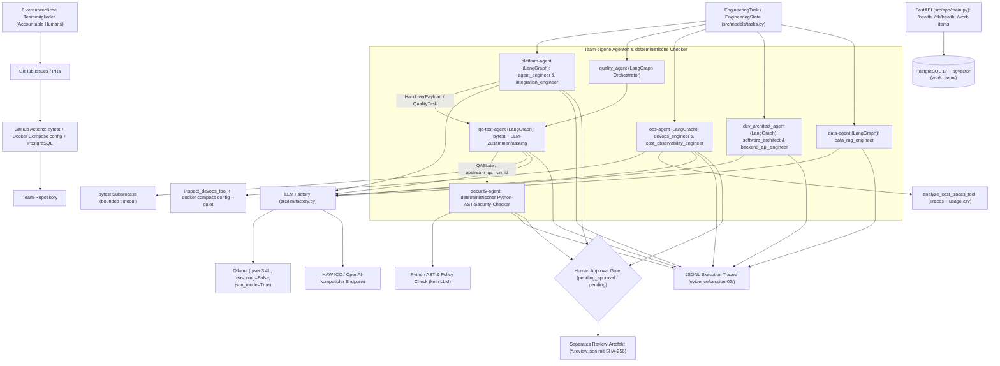

# Architektur – mimumisaseya gmbh

**Stand:** 26. Oktober 2026 (Termin 2 / Vorbereitung Termin 3). Die Architektur bildet den tatsächlich implementierten, getesteten und durch Ausführungstraces belegten Systemstand ab. Sämtliche in Termin 1 noch als geplant markierten Komponenten (persistente Work-Item-API auf PostgreSQL, gemeinsames Task-/State-Modell, Agent-to-Agent-Handover-Workflows, echte Ops-Laufnachweise sowie separate kryptografisch gebundene Human-Review-Artefakte) sind vollständig realisiert.

## Tatsächlicher technischer Aufbau

## Realisierte Komponenten und Unterstützungsarten der Rollen

1. **Persistente Work-Item-API (`src/app/main.py`, `src/app/db.py`, `db/init.sql`, `tests/test_work_items_api.py`):**
   - FastAPI-Service mit `/health`, `/db/health` sowie den produktiven CRUD-Endpunkten `POST /work-items`, `GET /work-items`, `PATCH /work-items/{item_id}/complete` und `DELETE /work-items/{item_id}`.
   - Echte PostgreSQL-Persistenz in der Tabelle `work_items` (verifiziert gegen den laufenden Container `pgvector/pgvector:0.8.6-pg17-bookworm` ohne übersprungene Tests: **123 passed, 0 skipped** in `evidence/session-02/pytest.txt`).
2. **Gemeinsames Task- und State-Modell (`src/models/tasks.py`, `src/agents/task_models.py`):**
   - Typisierte Pydantic-Modelle (`EngineeringTask`, `QualityTask`, `PlatformTask`, `HandoverPayload`) und `EngineeringState` mit einheitlicher `task_id`- und `workflow_id`-Weitergabe über Agentengrenzen hinweg (`extra="forbid"` verhindert das Einschleusen unautorisierter Freigabefelder).
3. **`platform-agent` & Agent-to-Agent-Workflow (`src/agents/platform_agent.py`):**
   - Unterstützt `agent_engineer` (Muhammad, Tool `inspect_agent_architecture_tool`) und `integration_engineer` (Saad, Tool `inspect_integration_contracts_tool`).
   - Orchestriert in `run_platform_to_qa_workflow` die technische Übergabe `platform-agent` $\rightarrow$ `HandoverPayload` $\rightarrow$ `qa-test-agent` $\rightarrow$ `human_gate`.
   - **Erzwungenes Human Gate:** Automatisierte Läufe enden zwingend bei `human_gate_status="pending_approval"` (bzw. `"changes_requested"` oder `"escalate_to_human"` bei Fehlern) und `approved_by_human=None`. `PlatformAgentResult` erzwingt `human_approval_required: Literal[True] = True`; selbst wenn ein LLM `"human_approval_required": false` oder `"human_gate_status": "approved"` ausgibt, überschreibt `_parse_result()` dies deterministisch auf `pending_approval`. Die menschliche Freigabe erfolgt ausschließlich getrennt über `record_platform_human_review()` in eine `.review.json`-Datei mit `report_sha256`-Bindung.
4. **Quality-Workflow mit `qa-test-agent` und deterministischem `security-agent` (`src/agents/quality_agent.py`, `src/agents/qa_test_agent.py`, `src/agents/security_agent.py`):**
   - `qa-test-agent` (Rolle `qa_test_engineer`, Felix) führt `pytest` als Subprozess mit Zeitlimit aus und nutzt `qwen3:4b` ausschließlich zur Zusammenfassung; der technische Exit-Code bestimmt unveränderbar den Status.
   - `security-agent` / `quality-security-checker` (Rolle `ai_safety_security_engineer`, Mirko) ist bewusst als **deterministischer statischer Python-AST- und Policy-Checker** (ohne LLM-Aufruf) implementiert (`inspect_python`). Er prüft Pfadgrenzen (`src/`, `tests/`, Schutz von `.env`), dynamische Codeausführung (`eval`/`exec`), Shell-Aufrufe (`os.system`, `shell=True`), literale Credentials (ohne Secret-Echo) sowie die Konsistenz des vorgelagerten QA-Ergebnisses (`upstream_qa_run_id`).
   - Der Gesamtworkflow endet bei `awaiting_human_review` (`human_decision="pending"`), bis ein Mensch über `quality_agent.record_human_review()` ein separates Review-Artefakt erzeugt.
5. **`ops-agent` für DevOps und Cost/Observability (`src/agents/ops_agent.py`):**
   - Unterstützt Mirko in zwei technisch getrennten Modi:
     - `devops` (`devops_engineer`): `inspect_devops_tool` prüft Dockerfile, Compose, CI-Workflow und gepinnte Dependencies und validiert über `docker compose config --quiet`.
     - `observability` (`cost_observability_engineer`): `analyze_cost_traces_tool` aggregiert JSONL-Traces (inkl. Fehlversuchen, Timeouts und Retries) sowie menschliche Review-/Korrekturzeiten und CI-Läufe aus `costs/usage.csv`.
   - Echte Ausführungstraces mit `qwen3:4b` und separate Review-Artefakte liegen unter `evidence/session-02/ops-agent-trace.jsonl` und `evidence/session-02/ops-*-report*.json`.
6. **`dev_architect_agent` (`src/agents/dev_architect_agent.py`) & Klärung des Modellpfads:**
   - Unterstützt `software_architect` (Minh, `sa-agent`) und `backend_api_engineer` (Mirko, `bae-agent`) mit Repository-Read/Write-Tools (`read_repo_file_tool`, `write_repo_file_tool`) und Sandbox-Guardrails.
   - **Klärung zu `gemini-3.5-flash-lite` im Trace:** In den ersten drei Einträgen von `evidence/session-02/dev-architect-agent-trace.jsonl` vom 19.10.2026 (`SESSION-02-ARCH-001`, `SESSION-02-DEV-001`) wurde `src/llm/factory.py` über den `openai_compatible`-Zweig mit einem lokal in `.env` eingetragenen externen Modellnamen (`gemini-3.5-flash-lite`) aufgerufen, nachdem Ollama ohne deaktiviertes Thinking in das 60s-Timeout lief. Für die Kursvorgaben (ausschließlich lokales Ollama `qwen3:4b` oder HAW ICC) wurde `dev_architect_agent.py` auf `get_chat_model(json_mode=True)` (wodurch `reasoning=False` gesetzt wird) umgestellt und beide Rollen (`SESSION-02-ARCH-002` und `SESSION-02-DEV-002`) vollständig mit dem lokalen Kursmodell `qwen3:4b` über Ollama ausgeführt und getraced. Die historischen Einträge bleiben zur vollständigen Kosten- und Fehlversuchstransparenz im Trace und in `costs/usage.csv` erhalten.
7. **`data-agent` (`src/agents/data_agent.py`):**
   - Unterstützt `data_rag_engineer` (Yaw) beim Einlesen, Abschnitt-Chunking (`read_project_document`) und Zusammenfassen von Projektdokumenten über LangGraph und Ollama `qwen3:4b` (dokumentiert in [`docs/data-agent-session-02.md`](data-agent-session-02.md)).

## Sicherheitsgrenzen und Human-in-the-Loop-Governance

Kein Agent besitzt Berechtigungen für produktive Deployments, Container-Neustarts, Datenbank-Migrationen außerhalb definierter API-Pfade oder Zugriffe auf `.env` / Dateien außerhalb des Repositorys. Alle Agentenläufe enden in einem nicht-freigegebenen Zustand (`pending_approval`, `awaiting_human_review`, `pending` oder `escalate_to_human`). Freigaben werden ausschließlich durch den jeweiligen Accountable Human gemäß [`organization/roles.yaml`](../organization/roles.yaml) als eigenständige, SHA-256-gebundene Review-Dateien protokolliert.

Auswertung des End-to-End-Dry-Runs und vollständige Kostenanalyse (inkl. Fehlversuchen, Retries und menschlichem Korrektur-/Reviewaufwand): [`docs/dry-run-01.md`](dry-run-01.md).
