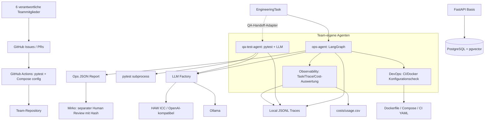

# Architektur – mimumisaseya gmbh

**Stand:** 19. Oktober 2026 (Termin 2). Wir unterscheiden implementierte Teile von geplanter Integration. Das Repository enthält noch keinen produktiven Deployment-Prozess mit technisch durchgesetzter Freigabe.

## Tatsächlicher technischer Aufbau

## Realisierte Komponenten

- `src/app/main.py`: FastAPI mit `/health` und `/db/health`; persistente Work-Items sind noch separat für den Dry Run zu implementieren.
- `src/agents/qa_test_agent.py`: Team-eigener QA-Agent mit pytest-Tool, LLM-Anbindung und Traces (Termin 1).
- `src/agents/ops_agent.py`: Zwei rollenspezifische, **read-only** LangGraph-Fähigkeiten: DevOps-Audit und Cost-/Observability-Audit. Maschinenlesbare JSON-Reports, JSONL-Traces, deterministische Kostenmessung und Fehler-/Eskalationspfad.
- `src/agents/task_models.py`: Gemeinsames Pydantic-`EngineeringTask`-Modell. Der bestehende QA-Agent kann es über `src/agents/task_handoffs.py` annehmen; ein orchestrierter Agent-to-Agent-Workflow und durchgehende `workflow_id`-Weitergabe durch QA müssen noch im Team integriert werden.
- `src/llm/factory.py`: Anbieterunabhängige Ollama-/ICC-Anbindung. `src/observability/tracing.py`: einheitlicher JSONL-Trace-/Credit-Helper.
- `.github/workflows/ci.yml`: CI-Pipeline mit Python 3.12, pytest, Docker-Compose-Validierung und PostgreSQL/pgvector. **Noch kein Produktions-Deployment und kein erzwungener Deployment-Gate.**

## Vorgaben und Sicherheitsgrenzen

Der Ops-Agent **liest** Konfiguration und Trace-Daten. Optional darf er `docker compose config --quiet` ausführen. Er hat keine Berechtigung zum Deployment, Container-Neustart, Dateischreiben in die Infrastruktur, Git-Merge oder Rollback. Auch bei bestandenem Audit kann nur ein Mensch über Freigabe / Änderungen / Eskalation entscheiden; die Entscheidung wird in einem getrennten Review-Artefakt mit überprüfbarem Report-Fingerprint gespeichert. Ein Review-Artefakt ersetzt keine technische CI-Deployment-Genehmigung.

GitHub-Issues, gemeinsame Tasks, Work-Item-Funktion und Agent-to-Agent-Orchestrierung sind Aufgaben des gesamten Teams für Termin 2. Geplante weitere Agenten (z. B. Data/RAG, Architecture) gelten **erst nach eigenem ausführbarem Code, Tests und realer Trace-Evidenz** als operational.

Die menschlichen Ansprechpartner der jeweiligen Rollen stehen in `organization/roles.yaml`. Für DevOps und Cost/Observability übernimmt Mirko die Freigabe/Verantwortung. Ausführliche Agent-Details und Kostenformeln: [`docs/OPS_AGENT.md`](OPS_AGENT.md). Kursvorgaben: [`docs/SESSION_02_DE.md`](SESSION_02_DE.md).
